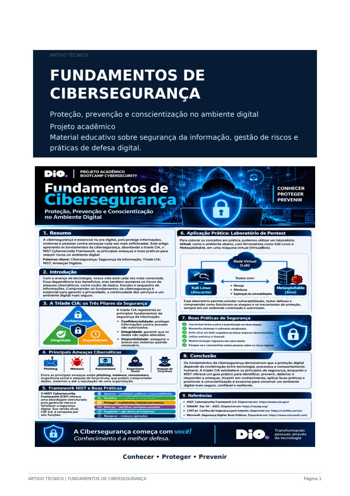
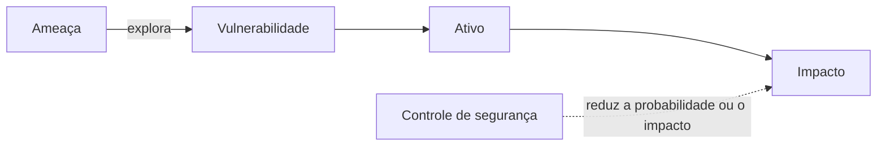
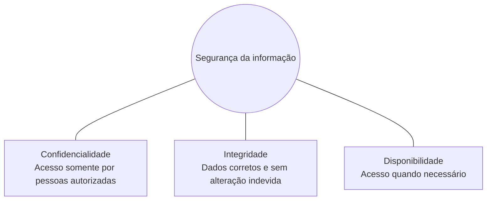
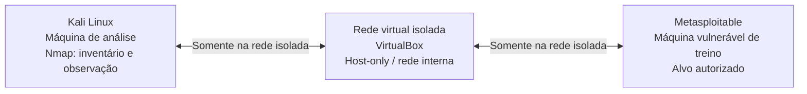
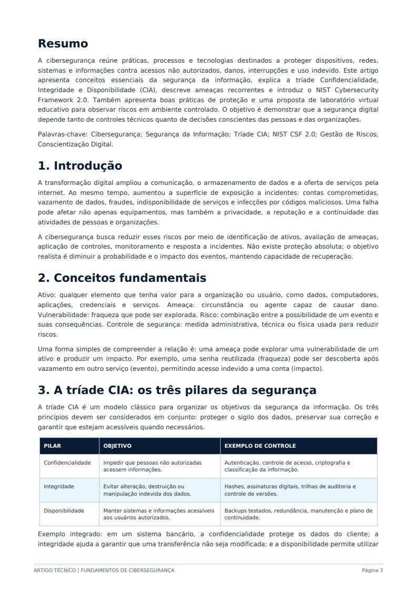
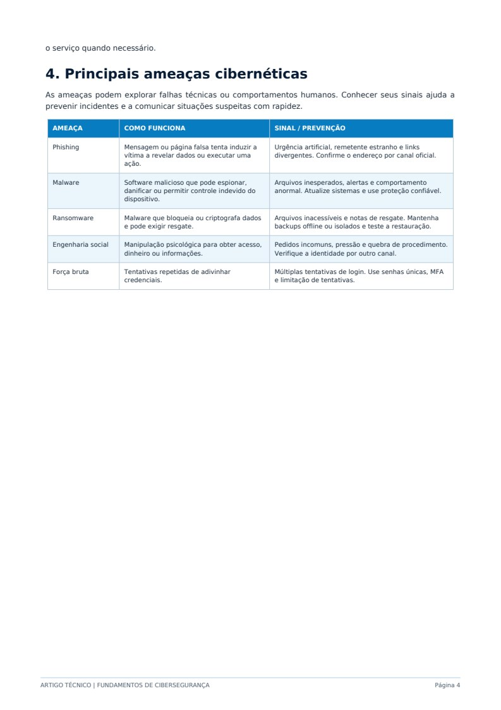
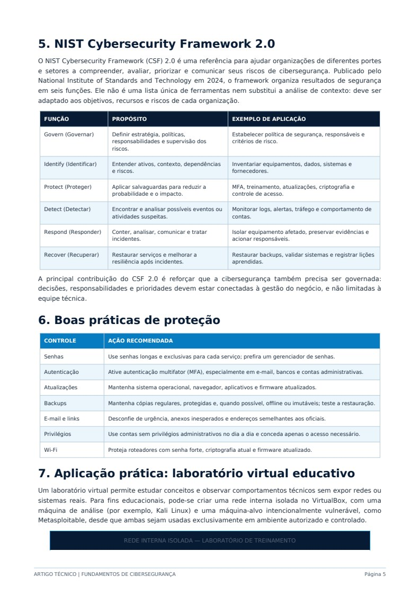
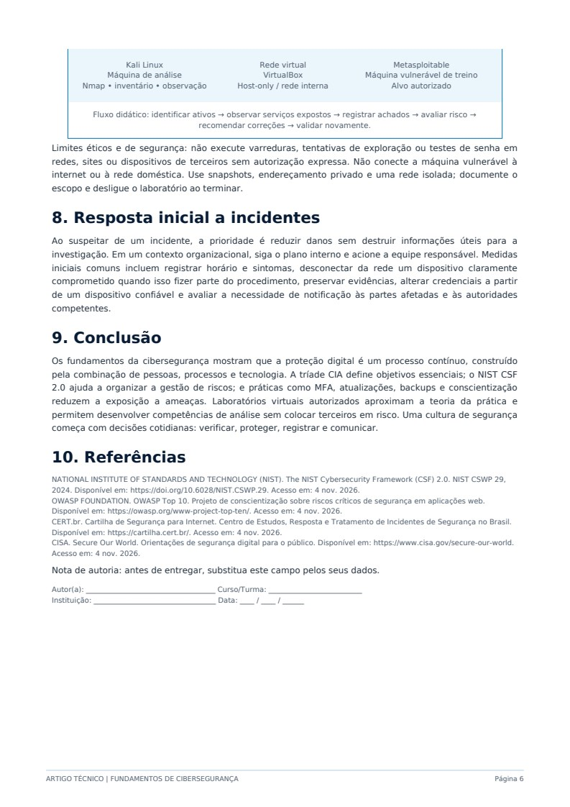

# Fundamentos de Cibersegurança

**Proteção, prevenção e conscientização no ambiente digital**

Projeto acadêmico — material educativo sobre segurança da informação, gestão de riscos e práticas de defesa digital.

## Resumo

A cibersegurança reúne práticas, processos e tecnologias destinados a proteger dispositivos, redes, sistemas e informações contra acessos não autorizados, danos, interrupções e uso indevido. Este artigo apresenta conceitos essenciais da segurança da informação, explica a tríade Confidencialidade, Integridade e Disponibilidade (CIA), descreve ameaças recorrentes e introduz o NIST Cybersecurity Framework 2.0. Também apresenta boas práticas de proteção e uma proposta de laboratório virtual educativo para observar riscos em ambiente controlado. O objetivo é demonstrar que a segurança digital depende tanto de controles técnicos quanto de decisões conscientes das pessoas e das organizações.

**Palavras-chave:** Cibersegurança; Segurança da Informação; Tríade CIA; NIST CSF 2.0; Gestão de Riscos; Conscientização Digital.

## 1. Introdução

A transformação digital ampliou a comunicação, o armazenamento de dados e a oferta de serviços pela internet. Ao mesmo tempo, aumentou a superfície de exposição a incidentes: contas comprometidas, vazamento de dados, fraudes, indisponibilidade de serviços e infecções por códigos maliciosos. Uma falha pode afetar não apenas equipamentos, mas também a privacidade, a reputação e a continuidade das atividades de pessoas e organizações.

A cibersegurança busca reduzir esses riscos por meio de identificação de ativos, avaliação de ameaças, aplicação de controles, monitoramento e resposta a incidentes. Não existe proteção absoluta; o objetivo realista é diminuir a probabilidade e o impacto dos eventos, mantendo capacidade de recuperação.

## 2. Conceitos fundamentais

- **Ativo:** qualquer elemento que tenha valor para a organização ou usuário, como dados, computadores, aplicações, credenciais e serviços.
- **Ameaça:** circunstância ou agente capaz de causar dano.
- **Vulnerabilidade:** fraqueza que pode ser explorada.
- **Risco:** combinação entre a possibilidade de um evento e suas consequências.
- **Controle de segurança:** medida administrativa, técnica ou física usada para reduzir riscos.

Uma forma simples de compreender a relação é: uma ameaça pode explorar uma vulnerabilidade de um ativo e produzir um impacto. Por exemplo, uma senha reutilizada (fraqueza) pode ser descoberta após vazamento em outro serviço (evento), permitindo acesso indevido a uma conta (impacto).

## 3. A tríade CIA: os três pilares da segurança

A tríade CIA é um modelo clássico para organizar os objetivos da segurança da informação. Os três princípios devem ser considerados em conjunto: proteger o sigilo dos dados, preservar sua correção e garantir que estejam acessíveis quando necessários.

| Pilar | Objetivo | Exemplo de controle |
|---|---|---|
| Confidencialidade | Impedir que pessoas não autorizadas acessem informações. | Autenticação, controle de acesso, criptografia e classificação da informação. |
| Integridade | Evitar alteração, destruição ou manipulação indevida dos dados. | Hashes, assinaturas digitais, trilhas de auditoria e controle de versões. |
| Disponibilidade | Manter sistemas e informações acessíveis aos usuários autorizados. | Backups testados, redundância, manutenção e plano de continuidade. |

**Exemplo integrado:** em um sistema bancário, a confidencialidade protege os dados do cliente; a integridade ajuda a garantir que uma transferência não seja modificada; e a disponibilidade permite utilizar o serviço quando necessário.

## 4. Principais ameaças cibernéticas

As ameaças podem explorar falhas técnicas ou comportamentos humanos. Conhecer seus sinais ajuda a prevenir incidentes e a comunicar situações suspeitas com rapidez.

| Ameaça | Como funciona | Sinal / prevenção |
|---|---|---|
| **Phishing** | Mensagem ou página falsa tenta induzir a vítima a revelar dados ou executar uma ação. | Urgência artificial, remetente estranho e links divergentes. Confirme o endereço por canal oficial. |
| **Malware** | Software malicioso que pode espionar, danificar ou permitir controle indevido do dispositivo. | Arquivos inesperados, alertas e comportamento anormal. Atualize sistemas e use proteção confiável. |
| **Ransomware** | Malware que bloqueia ou criptografa dados e pode exigir resgate. | Arquivos inacessíveis e notas de resgate. Mantenha backups offline ou isolados e teste a restauração. |
| **Engenharia social** | Manipulação psicológica para obter acesso, dinheiro ou informações. | Pedidos incomuns, pressão e quebra de procedimento. Verifique a identidade por outro canal. |
| **Força bruta** | Tentativas repetidas de adivinhar credenciais. | Múltiplas tentativas de login. Use senhas únicas, MFA e limitação de tentativas. |

## 5. NIST Cybersecurity Framework 2.0

O NIST Cybersecurity Framework (CSF) 2.0 é uma referência para ajudar organizações de diferentes portes e setores a compreender, avaliar, priorizar e comunicar seus riscos de cibersegurança. Publicado pelo National Institute of Standards and Technology em 2024, o framework organiza resultados de segurança em seis funções. Ele não é uma lista única de ferramentas nem substitui a análise de contexto: deve ser adaptado aos objetivos, recursos e riscos de cada organização.

| Função | Propósito | Exemplo de aplicação |
|---|---|---|
| **Govern (Governar)** | Definir estratégia, políticas, responsabilidades e supervisão dos riscos. | Estabelecer política de segurança, responsáveis e critérios de risco. |
| **Identify (Identificar)** | Entender ativos, contexto, dependências e riscos. | Inventariar equipamentos, dados, sistemas e fornecedores. |
| **Protect (Proteger)** | Aplicar salvaguardas para reduzir a probabilidade e o impacto. | MFA, treinamento, atualizações, criptografia e controle de acesso. |
| **Detect (Detectar)** | Encontrar e analisar possíveis eventos ou atividades suspeitas. | Monitorar logs, alertas, tráfego e comportamento de contas. |
| **Respond (Responder)** | Conter, analisar, comunicar e tratar incidentes. | Isolar equipamento afetado, preservar evidências e acionar responsáveis. |
| **Recover (Recuperar)** | Restaurar serviços e melhorar a resiliência após incidentes. | Restaurar backups, validar sistemas e registrar lições aprendidas. |

A principal contribuição do CSF 2.0 é reforçar que a cibersegurança também precisa ser governada: decisões, responsabilidades e prioridades devem estar conectadas à gestão do negócio, e não limitadas à equipe técnica.

## 6. Boas práticas de proteção

| Controle | Ação recomendada |
|---|---|
| Senhas | Use senhas longas e exclusivas para cada serviço; prefira um gerenciador de senhas. |
| Autenticação | Ative autenticação multifator (MFA), especialmente em e-mail, bancos e contas administrativas. |
| Atualizações | Mantenha sistema operacional, navegador, aplicativos e firmware atualizados. |
| Backups | Mantenha cópias regulares, protegidas e, quando possível, offline ou imutáveis; teste a restauração. |
| E-mail e links | Desconfie de urgência, anexos inesperados e endereços semelhantes aos oficiais. |
| Privilégios | Use contas sem privilégios administrativos no dia a dia e conceda apenas o acesso necessário. |
| Wi-Fi | Proteja roteadores com senha forte, criptografia atual e firmware atualizado. |

## 7. Aplicação prática: laboratório virtual educativo

Um laboratório virtual permite estudar conceitos e observar comportamentos técnicos sem expor redes ou sistemas reais. Para fins educacionais, pode-se criar uma rede interna isolada no VirtualBox, com uma máquina de análise (por exemplo, Kali Linux) e uma máquina-alvo intencionalmente vulnerável, como Metasploitable, desde que ambas sejam usadas exclusivamente em ambiente autorizado e controlado.

**Fluxo didático:** identificar ativos → observar serviços expostos → registrar achados → avaliar risco → recomendar correções → validar novamente.

### Limites éticos e de segurança

Não execute varreduras, tentativas de exploração ou testes de senha em redes, sites ou dispositivos de terceiros sem autorização expressa. Não conecte a máquina vulnerável à internet ou à rede doméstica. Use snapshots, endereçamento privado e uma rede isolada; documente o escopo e desligue o laboratório ao terminar.

## 8. Resposta inicial a incidentes

Ao suspeitar de um incidente, a prioridade é reduzir danos sem destruir informações úteis para a investigação. Em um contexto organizacional, siga o plano interno e acione a equipe responsável. Medidas iniciais incluem registrar horário e sintomas, desconectar da rede um dispositivo claramente comprometido quando isso fizer parte do procedimento, preservar evidências, alterar credenciais a partir de um dispositivo confiável e avaliar a necessidade de notificação às partes afetadas e às autoridades competentes.

## 9. Conclusão

Os fundamentos da cibersegurança mostram que a proteção digital é um processo contínuo, construído pela combinação de pessoas, processos e tecnologia. A tríade CIA define objetivos essenciais; o NIST CSF 2.0 ajuda a organizar a gestão de riscos; e práticas como MFA, atualizações, backups e conscientização reduzem a exposição a ameaças. Laboratórios virtuais autorizados aproximam a teoria da prática e permitem desenvolver competências de análise sem colocar terceiros em risco. Uma cultura de segurança começa com decisões cotidianas: verificar, proteger, registrar e comunicar.

## 10. Referências

- **National Institute of Standards and Technology (NIST).** *The NIST Cybersecurity Framework (CSF) 2.0.* NIST CSWP 29, 2024. Disponível em: <https://doi.org/10.6028/NIST.CSWP.29>. Acesso em: 4 nov. 2026.
- **OWASP Foundation.** *OWASP Top 10.* Projeto de conscientização sobre riscos críticos de segurança em aplicações web. Disponível em: <https://owasp.org/www-project-top-ten/>. Acesso em: 4 nov. 2026.
- **CERT.br.** *Cartilha de Segurança para Internet.* Disponível em: <https://cartilha.cert.br/>. Acesso em: 4 nov. 2026.
- **CISA.** *Secure Our World.* Orientações de segurança digital para o público. Disponível em: <https://www.cisa.gov/secure-our-world>. Acesso em: 4 nov. 2026.

> **Nota de autoria:** antes de entregar, substitua este campo pelos seus dados.
>
> Autor(a): Kennedy Aderson de Carvalho  
> Curso/Turma: Bootvamp Santander - Cibersegurança
> Instituição:DIO.me
> Data: 04/11/2026

## Páginas originais

As imagens abaixo preservam a diagramação e os elementos visuais das páginas fornecidas. O conteúdo textual foi organizado acima em Markdown.

Ver páginas originais

### Página 1 — capa e infográfico

### Página 3 — resumo, introdução, conceitos e tríade CIA

### Página 4 — ameaças cibernéticas

### Página 5 — NIST CSF, boas práticas e início do laboratório

### Página 6 — laboratório, resposta a incidentes, conclusão e referências

